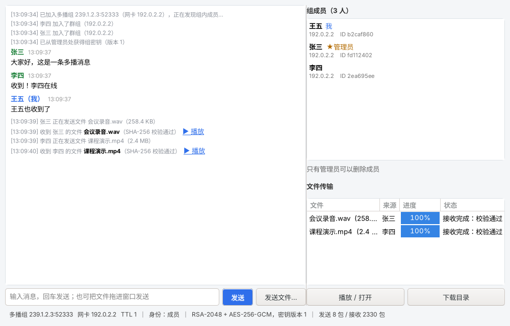
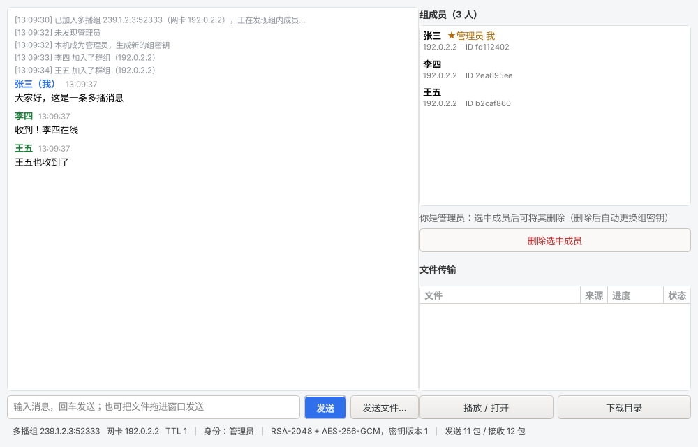
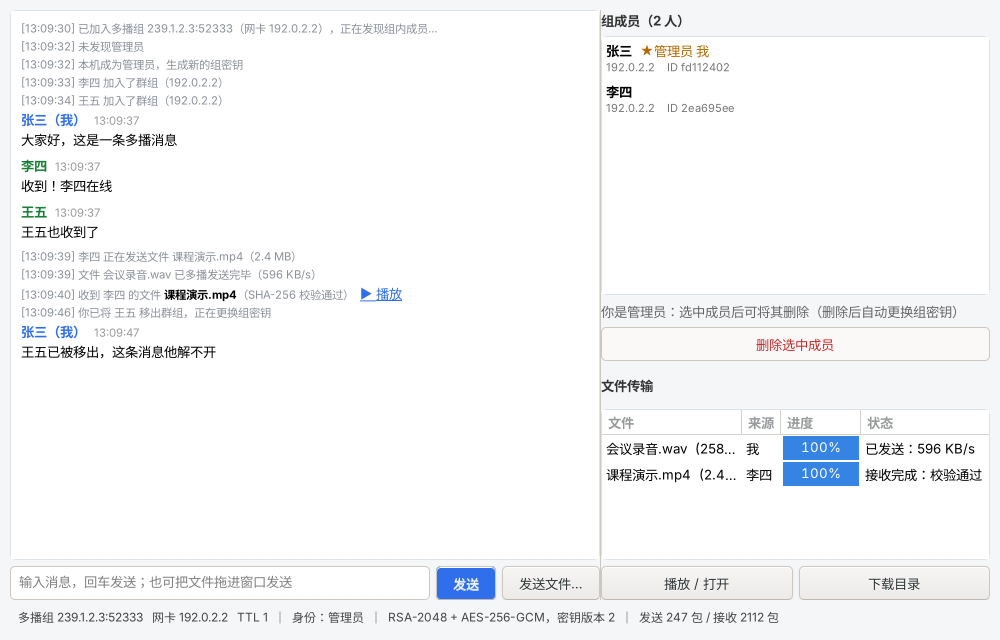
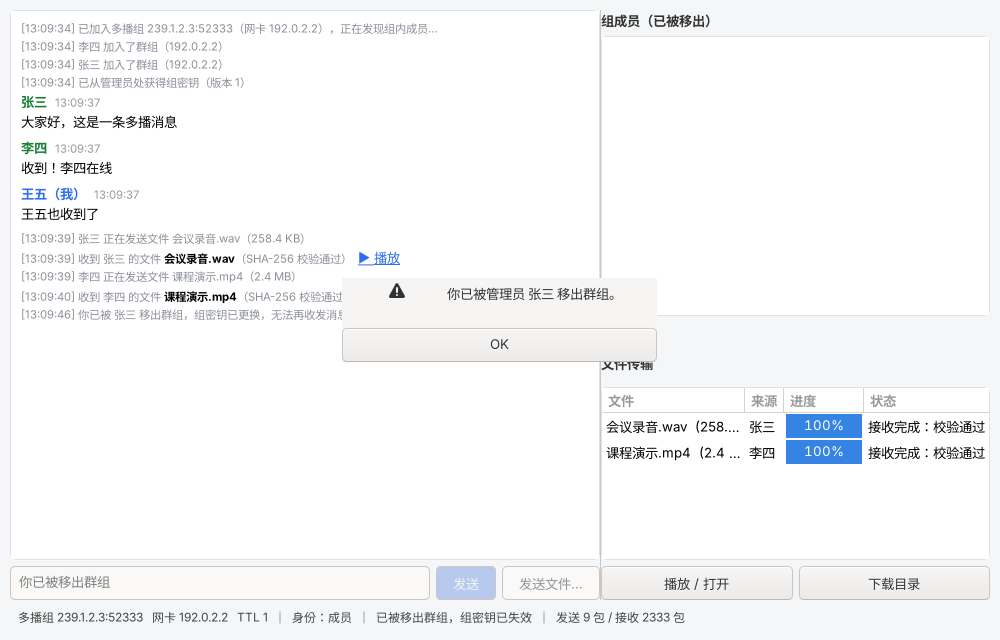

# McastChat —— 带文件传输功能的多播聊天工具（C 语言 / Ubuntu）

网络编程大作业（第 3 题）。用 C 语言基于 **UDP 多播** 实现的 1-N 聊天工具，支持文件（音视频）多播传输与播放、组成员管理，以及基于非对称密钥的加密传输。运行环境为 Ubuntu，图形界面使用 GTK3，加密使用 OpenSSL。



## 功能

| 题目要求 | 实现 |
|---|---|
| a. 聊天文本传输 | 文本直接多播到组地址，所有成员同时收到 |
| b. 文件（音视频）传输与播放 | 分片多播，接收方按序号重组并做 SHA-256 校验；点击"▶ 播放"用系统默认播放器打开 |
| c. 组成员管理（显示、删除） | 应用层心跳维护在线成员列表；管理员删除成员后**更换组密钥**，被删除者无法再解密任何新消息 |
| d. 非对称密钥加密（加分项） | RSA-2048 分发 AES-256 组密钥，文本和文件分片均用 AES-256-GCM 加密；管理报文带 RSA-PSS 签名 |
| 附加：丢包重传 | 基于 NACK 的补发，**默认关闭**，用 `--retransmit` 开启 |

## 为什么不是"聊天室"

题目要求必须用多播实现，做成"客户端连服务器、由服务器转发消息"的聊天室不合格。本项目中：

- 每条聊天消息、每个文件分片都由发送者直接 `sendto()` 到多播地址 `239.1.2.3`，由网络复制送达全组；
- 程序中没有任何"收到别人的消息再转发"的代码，所有节点运行同一个程序；
- "管理员"只是一个普通节点，额外负责分发组密钥和删除成员。它不转发消息，下线后由其他成员自动接任，其余成员照常聊天。

`docs/capture.txt` 是一次会话的抓包记录：节点加组时发出 IGMPv3 成员报告，所有数据报的目的地址都是 `239.1.2.3`。

## 编译

在 Ubuntu 20.04 / 22.04 / 24.04 上：

```bash
sudo apt install build-essential pkg-config libssl-dev libgtk-3-dev
make            # 生成图形界面版 ./mcastchat（同时包含 --cli 命令行模式）
make cli        # 只生成命令行版 ./mcastchat-cli，不需要 GTK
make test       # 运行单元测试与多节点集成测试
```

播放收到的音视频依赖桌面默认播放器（`xdg-open`），Ubuntu 桌面版自带；如果没有，可安装 `vlc` 或 `ffmpeg`（程序会退回用 `ffplay` 播放）。

## 运行

图形界面（启动后在对话框中填写昵称、组地址等）：

```bash
./mcastchat
```

直接指定参数、跳过对话框：

```bash
./mcastchat --name 张三
```

命令行模式（服务器、虚拟机等没有图形界面的环境）：

```bash
./mcastchat --cli --name 李四
# 输入文字直接发送；/who 查看成员；/file <路径> 发送文件；
# /kick <昵称> 删除成员；/play <文件名> 播放收到的文件；/quit 退出
```

| 参数 | 默认值 | 说明 |
|---|---|---|
| `--name` | 无（弹出对话框） | 昵称 |
| `--group` | `239.1.2.3` | 多播组地址 |
| `--port` | `50000` | 多播端口 |
| `--iface` | 自动选择 | 用于多播的本机网卡 IP，多网卡（VPN、虚拟机网卡）时建议手动指定 |
| `--ttl` | `1` | 多播 TTL，1 表示不出本网段 |
| `--no-encrypt` | 关 | 关闭加密，便于用 Wireshark 观察明文 |
| `--retransmit` | 关 | 开启文件丢包重传 |
| `--rate` | `2048` | 文件发送限速（KB/s） |
| `--download-dir` | `~/McastChat` | 接收文件的保存目录 |
| `--cli` | 关 | 使用命令行界面 |

**同一台机器上可以开多个实例互相测试。** 多台机器测试时，组内所有成员的组地址、端口、加密设置需一致。收到的文件保存在 `~/McastChat/<昵称>-<ID前缀>/` 下。

## 设计

### 源码结构

```
src/
├── protocol.c/h   报文头编解码、带边界检查的二进制读写
├── net.c/h        多播 socket 创建、网卡探测
├── crypto.c/h     OpenSSL：RSA 身份、RSA-OAEP 密钥封装、RSA-PSS 签名、AES-256-GCM、SHA-256
├── members.c/h    成员表、选举排序、黑名单
├── filexfer.c/h   文件分片读取、位图重组、SHA-256 校验
├── node.c/h       节点协议逻辑（不依赖界面）：发现、选举、密钥、踢人、收发、重传
├── cli.c/h        命令行界面
├── gui.c/h        GTK3 图形界面
└── main.c         入口与参数解析
tests/
├── test_unit.c    单元测试
├── test_node.c    本机多节点集成测试
└── gui_demo.c     打开 3 个窗口自动演示并截图
```

协议逻辑全部在 `node.c`，界面只通过事件回调与它交互，所以同一套逻辑既能跑 GTK 界面，也能跑命令行和自动化测试。

每个节点有两个后台线程：接收线程（阻塞 `recvfrom`）和定时线程（每 0.25 秒处理心跳、超时、选举、文件完整性）；发送文件和补发各开一个工作线程。共享状态由一把递归互斥锁保护。GTK 界面收到回调后把事件复制一份，用 `g_idle_add` 交回主线程处理，界面控件只在主线程中访问。

### 多播 socket

- 绑定 `INADDR_ANY:端口`，设置 `SO_REUSEADDR`，使同机多个实例可共用端口（内核把多播包复制给每个 socket）；
- `IP_ADD_MEMBERSHIP` 在指定网卡上加入组，内核随即发出 IGMP 成员报告；
- `IP_MULTICAST_IF` 指定出口网卡，`IP_MULTICAST_TTL` 默认 1，`IP_MULTICAST_LOOP` 开启以便同机实例互通；
- 接收缓冲区调到 4 MB，减少文件传输时的溢出丢包；`SO_RCVTIMEO` 设为 0.3 秒，便于线程及时退出；
- 自己发出的包会回环收到，按发送者 ID 过滤掉。

### 报文格式

每个数据报 = 20 字节头部 + 载荷，全部为网络字节序的二进制字段：

| 字段 | 长度 | 说明 |
|---|---|---|
| magic | 2 B | 固定 `MC`，过滤无关数据包 |
| version | 1 B | 协议版本 |
| type | 1 B | 报文类型 |
| sender_id | 8 B | 节点 ID = SHA-256(RSA 公钥 DER) 前 8 字节 |
| seq | 4 B | 发送者自增序号 |
| key_epoch | 4 B | 所用组密钥版本，0 表示明文 |

| 类型 | 载荷 | 保护方式 |
|---|---|---|
| `HELLO` / `HEARTBEAT` | 上线时间、标志位（管理员/有密钥/加密）、密钥版本、昵称、RSA 公钥 | 明文（公钥本就公开） |
| `BYE` | 空 | 明文 |
| `KEY_DIST` | 目标 ID、密钥版本、是否丢弃旧钥、RSA-OAEP(组密钥)、时间戳 | RSA 加密 + 管理员签名 |
| `KICK` | 目标 ID、时间戳 | 管理员 RSA-PSS 签名 |
| `CHAT` | UTF-8 文本 | AES-256-GCM |
| `FILE_META` | 文件 ID、大小、分片数、SHA-256、文件名 | AES-256-GCM |
| `FILE_CHUNK` | 文件 ID、分片序号、1200 字节数据 | AES-256-GCM |
| `FILE_END` | 文件 ID、分片数 | AES-256-GCM |
| `NACK` | 文件 ID、是否要元信息、缺失区间列表 | AES-256-GCM |

加密报文的载荷为 `nonce(12B) + 密文 + tag(16B)`，并把 20 字节头部作为 GCM 附加认证数据，头部被篡改也会认证失败。所有解析都经过带边界检查的读取函数，畸形报文不会越界。

### 成员管理与管理员

多播本身不提供成员列表（IGMP 只让路由器知道"这个网段有人要收"），因此在应用层维护：

- 上线发 `HELLO`，其他节点立即回一次 `HEARTBEAT`，新成员很快就能看到完整列表；
- 之后每 2 秒一次心跳，6 秒收不到判定离线；正常退出发 `BYE`。

管理员选举：

1. 新节点启动后监听 2 秒，听到管理员心跳就作为普通成员加入，等待密钥；
2. 没听到就自己成为管理员，生成第 1 版组密钥；
3. 管理员离开后，剩余成员中上线最早者（相同则比较 ID）自动接任，并生成新版本密钥；
4. 若同时出现两个管理员（几乎同时启动），上线较晚的一方自动让位。

### 加密与密钥分发

1. 每个节点启动时生成 RSA-2048 密钥对，公钥随心跳广播；节点 ID 由公钥哈希得到，收到心跳时核对 ID 与公钥是否匹配；
2. 管理员从心跳中发现某成员没有当前版本密钥，就用它的公钥加密组密钥，通过 `KEY_DIST` 发给它（丢包了下一次心跳会再触发，限速 1 秒一次）；
3. 成员只接受当前管理员签名正确的 `KEY_DIST` 和 `KICK`，伪造的管理报文会被丢弃；
4. 有成员离开时管理员也会换一次密钥，离开者无法解密之后的消息。

### 删除成员（"真正踢掉"）

在网络层无法阻止一台主机加入多播组、收到数据包，所以删除通过**更换组密钥**实现：

1. 管理员多播签名的 `KICK` 报文；
2. 管理员生成新版本组密钥，只发给剩余成员，并要求立即丢弃旧密钥；
3. 被删除者仍能抓到数据包，但没有新密钥，解不开；
4. 其他成员把被删除者的 ID 加入黑名单，即使它拿到密钥发来消息也不接收；
5. 被删除者的程序收到 `KICK` 后提示并停止收发；如果它不肯退出继续发心跳，管理员会每 3 秒重发一次 `KICK`。

### 文件传输

1. 发送方计算 SHA-256，多播两次 `FILE_META`；
2. 按序号多播 `FILE_CHUNK`，每片 1200 字节，加上各层头部共 1288 字节，小于以太网 MTU，不会被 IP 分片；
3. 按 `--rate` 限速，避免接收方缓冲区溢出；
4. 多播三次 `FILE_END`；
5. 接收方用 `pwrite` 把每个分片写到文件对应偏移、用位图记录收到情况，收齐后校验 SHA-256，一致才保存为正式文件；
6. 未开启重传时，有缺片就判定失败并报告丢了几个分片；开启 `--retransmit` 后，接收方多播 `NACK`（缺失分片压缩成区间），发送方合并 100 毫秒内所有接收方的请求后统一补发，连续 6 轮无进展才放弃。

接收文件名经过清理（去掉路径和非法字符），防止对方用 `../` 之类的文件名写到下载目录以外。

## 测试

```bash
make test     # 单元测试 61 项检查 + 集成测试 12 个场景 48 项检查
make asan     # 用 AddressSanitizer + UBSan 编译后再跑一遍，检查内存错误
```

- **单元测试**（`tests/test_unit.c`）：报文头编解码与非法报文、读写越界拦截、数据报不超过 MTU、AES-GCM 错误密钥与头部/密文篡改、RSA 密钥封装与签名、文件名清理、乱序重组与重复分片、哈希校验失败；
- **集成测试**（`tests/test_node.c`）：本机启动多个节点经真实 UDP 多播通信，覆盖管理员选举与密钥分发、1-N 聊天、文件传输与校验、删除成员后被删者无法解密且其消息被拒收、管理员离开后自动接任、成员超时判定、同时启动只保留一个管理员、明文模式、20% 随机丢包下重传恢复、不开重传时丢包被正确报告、伪造踢人报文被忽略、普通成员不能删人。

`make screenshots` 在虚拟显示器中打开三个窗口走完整流程并截图（需要 `xvfb`），`docs/screenshots/` 中的图片即由它生成。

多机测试：把几台电脑接到同一个交换机或手机热点下，分别运行程序；用 Wireshark 过滤 `igmp || udp.port == 50000` 可以看到 IGMP 加组报告和发往 `239.1.2.3` 的数据包，开启加密时载荷为密文，加 `--no-encrypt` 可看到明文。

## 截图

| 管理员视角 | 文件接收完成 |
|---|---|
|  |  |
| 删除成员后（管理员） | 被删除者 |
|  |  |

## 已知限制

- 校园网和部分 WiFi 路由器会隔离或丢弃多播包，多机测试建议使用有线交换机或手机热点；多网卡电脑需用 `--iface` 指定网卡。虚拟机请使用桥接网络，NAT 模式下多播通常无法到达其他主机。
- 没有证书体系，成员公钥采用"首次见到即信任"，无法防御中间人；任何节点都可以声称自己上线更早来争夺管理员。
- 被删除者仍能在网络层收到密文；它可以生成新的 RSA 密钥、以新身份重新加入，此时需要管理员再次删除。
- 删除成员的 `KICK` 与新密钥到达之间的极短时间内，其他成员可能仍用旧密钥发出消息，被删除者理论上能解开这一小段。
- 未开启重传时，文件传输不保证完整（会明确报告失败）。
- 成员表上限 64 人，同时发送文件上限 16 个。
